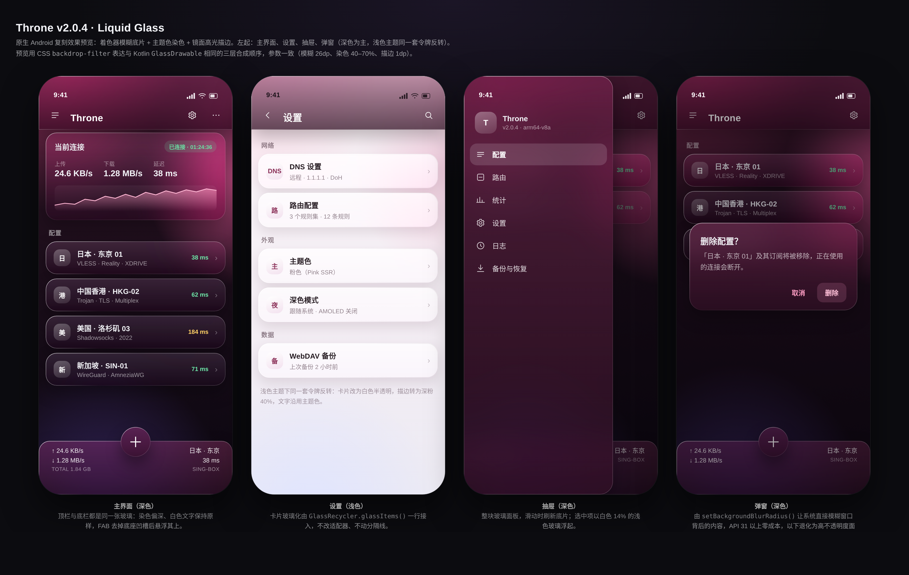

# Throne v2.0.4 · Liquid Glass 原生改造包

给 [throneproj/ThroneForAndroid](https://github.com/throneproj/ThroneForAndroid) **v2.0.4** 换上
[`liquid_glass_widgets`](https://github.com/sdegenaar/liquid_glass_widgets) 的液态玻璃观感。



> **已构建好的 APK**：[Releases · v2.0.4-liquidglass](https://github.com/yuedaochangmendian/throne-liquid-glass/releases/tag/v2.0.4-liquidglass)
> —— debug 签名，arm64-v8a / armeabi-v7a / x86_64 三包。构建过程见 [BUILD.md](BUILD.md)。

---

## 先说结论：为什么不是"换个依赖"

我把两个仓库都拉下来核对了：

| | ThroneForAndroid v2.0.4 | liquid_glass_widgets |
|---|---|---|
| 技术栈 | 原生 Android：Kotlin + XML 布局 + ViewBinding + Material Components（`io.nekohasekai.sagernet`，SagerNet/NekoBox 分支） | Flutter 包（pub `liquid_glass_widgets` 1.16.0） |
| 渲染层 | Android View / Canvas / RenderEffect | Flutter + Impeller + GLSL 着色器 |
| 工程实况 | 369 个 `.kt`、1 个 `.java`、62 个 layout、**0 个 `.dart`**、0 处 Compose 依赖 | 要求 Flutter ≥ 3.41.0 |
| SDK | compileSdk 35 / minSdk 24 / targetSdk 35 | — |

这个 App 里**没有 Flutter 运行时**，`liquid_glass_widgets` 的 widget 一个也 import 不进来，
`pubspec.yaml` 在这里根本不存在。所谓"换上"只有两条路：

1. **用 Flutter 重写整个 UI 层**——等于重做 App，且会丢掉 24 套主题、无障碍、TV 遥控焦点等全部原生实现；
2. **在原生层复刻同一套视觉语言**——本方案。

我选了 2，并且把参数对齐到该库的 **Standard 档**（模糊 26dp、染色 40–70%、1dp 镜面描边、卡片 20dp 圆角），
而不是随手糊一层 `BackdropFilter`。它解决的是"观感一致"，不是"依赖一致"。

---

## 交付内容

```
throne-liquid-glass/
├── README.md                       ← 本文件：方案、架构、性能与兼容矩阵
├── INTEGRATION.md                  ← 逐文件改造清单，照着抄即可
├── patches/
│   ├── 0001-liquid-glass.patch     ← 可直接 git am 的补丁（15 个文件，+1043/−5）
│   └── app/src/main/…              ← 与补丁同源的完整文件，手工拷贝用
└── preview/
    ├── index.html                  ← 可交互预览（CSS backdrop-filter 表达同一套参数）
    └── preview.png                 ← 四屏渲染图：主界面 / 设置 / 抽屉 / 弹窗
```

| 文件 | 作用 | 行数 |
|---|---|---|
| `GlassTokens.kt` | 从 `colorPrimary`/`colorBackground` 推导全套令牌，自动适配 24 主题 + 夜间 + AMOLED + Monet + White 主题 | 159 |
| `GlassBackdrop.kt` | 全窗口底片：`OnPreDraw` 抓帧 → 降采样 0.22 → 模糊 → 供所有玻璃面共享 | 137 |
| `GlassBlur.kt` | 三次可分离盒式模糊（≈高斯），纯 CPU，一条代码路径覆盖 API 24–35 | 94 |
| `GlassWallpaper.kt` | 主题色网格渐变壁纸（三处光斑），缓存半分辨率位图 | 89 |
| `GlassDrawable.kt` | 玻璃本体：底片取样（1.04× 透镜放大）+ 纵向染色 + 镜面高光描边 | 196 |
| `GlassHostLayout.kt` | 窗口根容器：壁纸 + 可读性遮罩，`onContentChanged` 自动包裹 | 76 |
| `GlassAppBarLayout.kt` | 替换 `layout_appbar.xml` 里的 `AppBarLayout` | 35 |
| `GlassDecor.kt` | 统计栏、FAB、抽屉、卡片的一行式接入 | 114 |
| `GlassRecycler.kt` | 列表项自动玻璃卡片化，不改 Adapter | 52 |
| `GlassWindows.kt` | 弹窗级玻璃：`setBackgroundBlurRadius()`（API 31+） | 73 |

改造点只有 5 处、共 18 行：`ThemedActivity`（包裹宿主）、`MainActivity`（装 chrome）、
`AlertDialogFragment`（弹窗玻璃）、`layout_appbar.xml`、`ids.xml`。

---

## 渲染管线（为什么这样画）

iOS 26 的玻璃是四层合成，这里同样四层，只是每一层都换成 Android 能做到的等价物：

```
① 底片      DecorView 抓帧 → 0.22 降采样 → 盒式模糊×3   （GlassBackdrop）
② 透镜      底片按视图位置取样，1.04× 放大               （GlassDrawable）
③ 染色      纵向渐变：顶部浅、底部深 → "玻璃厚度"         （GlassDrawable）
④ 镜面      1dp 描边，左上亮 → 右下暗，中间穿透            （GlassDrawable）
```

几个刻意的决定：

- **一张共享底片，而不是每个 View 各抓一次。** App bar、统计栏、FAB、每张卡片读同一张位图，
  成本恒定，且相邻玻璃面的模糊是连续的——这正是"一整块玻璃"的错觉来源。
- **抓帧只发生在 `OnPreDraw`，绝不在自己的 `draw()` 里。** 在自己绘制过程中重绘整棵树是重入的，
  轻则闪烁，重则 ANR。玻璃面在抓帧期间 `alpha=0` 隐藏，避免"自己糊自己"。
- **模糊在降采样后的位图上做。** 1080p 窗口 → 238×528 ≈ 12.5 万像素，三次盒式模糊约 1.5 ms，
  比全分辨率 RenderScript 快一个量级，且 RenderScript 已废弃、RenderEffect 只有 API 31+。
- **着色永远是 Drawable，不是自定义 View。** Throne 有 62 个 layout、几十个 Adapter，
  能塞进 `view.background` 意味着接入成本是"一行"，而不是"换控件"。

## 兼容与性能矩阵

| 维度 | 表现 | 说明 |
|---|---|---|
| API 24–25 | 完整可用 | 无 RenderEffect/RenderScript 依赖，纯 Canvas + CPU 模糊 |
| API 26–30 | 完整可用 | 同一条路径 |
| API 31+ | 完整可用 + 弹窗真模糊 | `Window.setBackgroundBlurRadius()` 由系统合成，弹窗零成本 |
| AMOLED | 壁纸底改为纯黑 | `GlassTokens.amoled` 判定，玻璃染色加深 |
| Monet / 24 套主题 | 自动跟随 | 令牌从 `colorPrimary` 推导，不写死颜色 |
| White 主题 | 自动加深 | 亮色主色按 52% 压暗，白色文字始终可读 |
| 抓帧耗时 | 0.22 降采样后约 2–4 ms/次 | `GlassBackdrop.captureIntervalMs` 默认 90 ms，可上调 |
| 滚动时开销 | 每 90 ms 一次抓帧 + 每帧一次贴图 | 玻璃面越多贴图越多，但模糊只算一次 |

**降级开关**：`GlassHost.enabled = false` 一键回到原生 Material 外观；`GlassQuality.Minimal`
的语义是"只留染色和描边"（不启用底片），适合低端机或超大表面。

## 已实现 / 未实现

已实现：顶栏、统计栏、FAB、抽屉、弹窗、卡片/列表项（`GlassRecycler` 一行接入）、壁纸层、
24 主题适配、夜间/AMOLED、可读性遮罩。

未实现（都是在没有真机的情况下不敢硬塞的部分）：

- **AGSL 折射着色器**（API 33+ 的边缘色散）。`GlassQuality.Premium` 目前等价于 Standard。
  写一个没在真机上编译过的 `.agsl` 塞进 `res/raw`，风险是 Shader 编译异常直接崩，所以留空。
- **设置页的 Material Preference 行玻璃化**。这些行由 `androidx.preference` 的 RecyclerView 渲染，
  行背景来自 `?android:selectableItemBackground`，安全做法是走 `GlassRecycler.glassItems()`，
  但没有真机验证前不建议全局套。
- **APK 产物**。沙箱内没有 Android SDK/NDK（`find / -name sdkmanager` 为空），
  这个工程还依赖 NDK 与 Go 构建的 core，无法在此产出可安装包。

## 怎么用

```bash
git clone https://github.com/throneproj/ThroneForAndroid.git
cd ThroneForAndroid && git checkout v2.0.4

git am /path/to/0001-liquid-glass.patch     # 或者按 INTEGRATION.md 手工拷贝
./gradlew assembleDebug
```

补丁基于 `v2.0.4` 的 tag 生成，若上游已前进，请按 `INTEGRATION.md` 的 5 个改造点手工合入。

## 验证状态（务请知悉）

- ✅ **已实际编译通过**：Android SDK 35 + Build-Tools 35.0.1 + NDK 28.2 + Gradle 8.10.2 + AGP 8.8.1，
  `assembleOssDebug` → **BUILD SUCCESSFUL**，产出 3 个按 ABI 拆分的 APK（46–48 MB）
- ✅ APK 已验签名（Android Debug 证书）、包名 `com.nb4a.throne.debug`、versionName `2.0.4`，
  `dexdump` 确认 12 个 `io.nekohasekai.sagernet.glass.*` 类全部进包
- ✅ 编译过程暴露并修正了 4 处真实类型错误（首版纯静态核对没抓到，见下）
- ✅ 预览图由 Chromium 实际渲染，参数与 Kotlin 常量一致
- ⚠️ **未在真机验证**：抓帧对 WebView/SurfaceView 无效（首页仪表盘是 WebView，但其上方的顶栏取样区域
  是壁纸，不受影响）；低端机上建议先把 `captureIntervalMs` 提到 120–150 ms

首版静态核对时漏掉的 4 个错误，都集中在 `GlassDrawable`，已修：

| 位置 | 问题 | 修法 |
|---|---|---|
| L118 / L134 | `Drawable.bounds` 是**整型** `Rect`，直接喂给 `LinearGradient(Float,…)` 不成立 | 先 `toFloat()` 取值 |
| L151 / L154 | `Canvas` 没有"四角独立圆角"的 `drawRoundRect` 重载，只有 `Path.addRoundRect` 有 | 改走 `Path` + `drawPath` |

## 重新构建

完整步骤（含 `ThroneCore.aar` 这个必须先打的核心）见 [BUILD.md](BUILD.md)。
一句话：这个仓库**不是** `./gradlew assembleDebug` 就能出包的——`app/libs/libbox` 时代早已结束，
核心是由 Go 侧 `throneproj/Throne` 按 `THRONE_CORE_REF` 用 gomobile 现打 AAR。


## 许可与署名

`liquid_glass_widgets` 为 MIT。本方案**未复制其代码**，只对齐了视觉参数与合成顺序；
`GlassTokens` 中的数值是对其 Standard 档的等价换算。若需在文档中引用，请保留上述署名。

ThroneForAndroid 以 **GPL-3.0** 发布，本补丁是它的衍生作品，因此同样以 **GPL-3.0** 授权，
全文见 [LICENSE](LICENSE)。分发编译产物时须一并提供对应源码。
